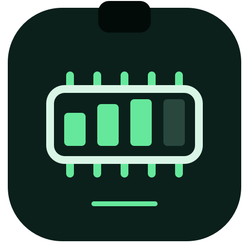

# MemoryUsageBar



A lightweight native macOS utility that shows **内存 65%** immediately to the right of your Mac's camera notch. The percentage is always green and represents **memory used / physical memory × 100**, rounded to the nearest whole percent. The bar contains no byte counts or parentheses.

## Features

- Universal application: native **Apple Silicon (arm64)** and **Intel (x86_64)** executables in one app. macOS selects the appropriate architecture automatically; Rosetta is not required on Apple Silicon.
- Refreshes every **60 seconds**, on launch, and after waking from sleep. The timer allows up to five seconds of scheduling tolerance to reduce wakeups. Click the bar and choose **Refresh Now** for an immediate update.
- Uses the actual screen geometry: eight points to the right of the notch, vertically centered in the top strip. No Mac model selection is required.
- Uses the first connected notched display. If none exists, places the bar eight points to the right of the primary display's horizontal center.
- Follows display configuration changes, supports light and dark appearances, and keeps a fixed width as the percentage changes.
- Click or right-click for refresh, **Launch at Login**, and quit options. No Dock icon or regular application window.
- Custom memory-chip logo, with editable [SVG source](assets/logo.svg) and a reproducible native icon generator.

## Requirements and installation

macOS **13 Ventura or later** on Apple Silicon or Intel.

Build the app below, then copy `build/MemoryUsageBar.app` into `/Applications` and open it from Finder. The overlay remains visible when switching applications. You can enable **Launch at Login** from its menu after moving the app into `/Applications`; macOS may ask you to approve it in System Settings → General → Login Items.

The app uses a small floating panel rather than a standard status item so its position can stay beside the notch. macOS does not reserve this space for the app: a crowded menu bar can overlap the text. Visibility in full-screen spaces depends on macOS and the foreground application's presentation settings. With no notch it uses the center-right fallback described above.

To upgrade, choose **Quit MemoryUsageBar**, replace the app, and open the new copy. To uninstall, disable **Launch at Login**, quit, and move the app to Trash.

Builds use an ad hoc signature and are **not notarized**. A downloaded build may trigger Gatekeeper; you can inspect and build the source locally. No Accessibility or Screen Recording permission is needed by the app.

## Build from source

Install Xcode or the Xcode Command Line Tools with a macOS SDK and Swift compiler. From the repository root:

```sh
./scripts/build.sh
./scripts/test.sh
```

The build script creates both architectures with a macOS 13 deployment target, combines them with `lipo`, generates the app icon, assembles the bundle, and applies an ad hoc signature. There are no third-party packages or network dependencies.

The result is `build/MemoryUsageBar.app`. Verify both architectures and inspect a live sample:

```sh
lipo -archs build/MemoryUsageBar.app/Contents/MacOS/MemoryUsageBar
build/MemoryUsageBar.app/Contents/MacOS/MemoryUsageBar --sample
```

The diagnostic command prints byte counts as well as the percentage. Byte counts are otherwise available only in the tooltip, not in the bar itself.

CI builds and tests on a macOS runner, then uploads a universal ZIP and SHA-256 checksum as a workflow artifact. Pushing a `v*` tag also publishes those files in a GitHub Release.

## Memory accounting

The app reads `HOST_VM_INFO64` using `host_statistics64`, the physical RAM size using `ProcessInfo.physicalMemory`, and the running system's page size using `host_page_size`. It does not assume 4 KiB or 16 KiB pages, so the same code works on Intel and Apple Silicon.

```text
nonPurgeableAnonymousPages = max(internal_page_count - purgeable_count, 0)
usedBytes = (nonPurgeableAnonymousPages + wire_count + compressor_page_count) × pageSize
usedBytes = min(usedBytes, physicalMemory)
percentage = round(100 × usedBytes / physicalMemory)
```

This counts anonymous resident memory, wired memory, and the physical storage occupied by compressed memory. Reclaimable file-backed cache and swap storage are excluded. It is a physical-memory usage estimate, not a memory-pressure score or the sum of process RSS. A value near 100% does not by itself indicate a problem. Activity Monitor may differ slightly due to sampling time, rounding, or OS accounting changes. If reading fails, the bar displays **内存 —** instead of an old percentage and retries at the next refresh.

References: [Apple VM statistics](https://developer.apple.com/documentation/kernel/vm_statistics64_data_t), [Apple kernel field definitions](https://github.com/apple-oss-distributions/xnu/blob/main/osfmk/mach/vm_statistics.h), and [NSScreen right-of-notch geometry](https://developer.apple.com/documentation/appkit/nsscreen/auxiliarytoprightarea-gr2n).

## Validation

`./scripts/test.sh` checks memory accounting with both 4 KiB and 16 KiB page sizes, purgeable subtraction, upper bounds, rounding, notch placement, screen origins, non-notch fallback, narrow screens, and live memory sampling. A universal build verifies that both architecture slices compile; it does not replace testing on physical Intel hardware. Launch-at-login approval and full-screen behavior should also be checked on the target Mac.

## Privacy

All memory statistics are read locally. The app does not use the network, collect analytics, read process names, inspect window contents, or store memory samples. It needs no account or credentials. Launch-at-login registration is managed by macOS and is off until you enable it.

## License

[MIT](LICENSE).

See [Security review](SECURITY_REVIEW.md) for the pre-upload inspection scope, checks, and limitations.
